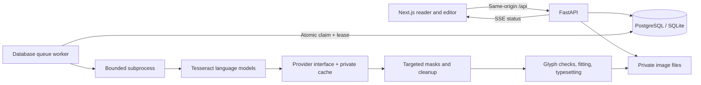

# Architecture

## Data model

`sessions` own `projects` (one chapter each). Projects have ordered `pages` and `glossary` entries. Pages have `regions` and durable `jobs`. Regions retain OCR text, geometry, word boxes, language/confidence, translation, rendering parameters and review notices; edits are recorded in `edits`, and quality reports in `feedback`. `cache` contains session-scoped OCR or translation payloads. Original, thumbnail, mask, cleaned and final images are separate files identified by internal UUIDs, never supplied paths.

This schema deliberately does not introduce unused users, series, export jobs or translation-version tables. Add those with subsequent Alembic migrations when their features exist. Initial migration `0001` contains frozen explicit baseline schema operations. Migration `0002` enforces one queued/running job per page through a partial unique index. Add future changes as new revisions.

## Worker guarantees

The API commits a page job before responding. Workers choose the oldest eligible job, ordered by page priority, and claim it using a conditional atomic UPDATE. The lease exceeds the subprocess timeout. Expired running jobs return to the queue up to three claims. Technical provider/OCR errors remain explicit. Individual region failures preserve useful neighboring results; empty or uncertain recognition produces Needs Review with manual recovery.

Each claimed job runs in an isolated subprocess. The parent kills it on timeout. Default worker concurrency is one; this preserves preceding-page context and limits memory. Multiple worker processes are safe to claim jobs under PostgreSQL, but strict chapter-order context requires one worker per chapter (not yet enforced for scaled deployments). Do not scale the native SQLite queue.

Progress commits at recognition, translation, cleanup, rendering and validation. Cancellation is checked between these stages. Generated files use temporary files and atomic replacement. A render-only job never invokes OCR or translation. The original file is never overwritten.

## Caching

OCR keys include owner/session, image digest, model file versions, source and direction. Translation keys include owner, all selected text, source/target, provider endpoint/model identity, style, glossary, preceding context and profile. Final rendering uses saved regions and always keeps masks/clean images separate. This is cache reuse, not a storage-level deduplication system: duplicate originals stay private within each project. Model objects are cached only within one process.

## Image safety and constraints

Uploads are decoded and re-encoded into known formats. Multi-frame images are rejected. PDF rasterization is fixed at 144 DPI with pre-render pixel checks. Archive files are read in memory without extracting user paths. ZIP entry counts, expanded bytes and compression ratio are bounded. The full decoded chapter also has an aggregate pixel limit.

The primary page pass is bounded to a 2400px longest side, with coordinates mapped back to original pixels. Bubble crops are enlarged independently; sparse preprocessing and overlapping 1100px tiles with a 900px step provide bounded fallbacks. Overlap merging is geometric, not a trained model; difficult overlap cases need inspection. Pages beyond the configured pixel limit are rejected with an explanation.

Text cleanup selects connected ink components in a distinct source area; detected bubble polygons protect outlines, large connected illustrations are excluded, and user include/protect selections refine the mask. Unconfirmed proposals cannot erase pixels. Uniform local backgrounds are restored by masked color fill. Other masks use OpenCV Telea. Text fitting and font coverage are validated *before* removing the original ink. Typesetting does not alter any pixels outside the cleanup mask and newly drawn lettering, except that low-level image encoding remains lossless PNG.

## Privacy and deployment boundary

API keys are environment settings, never browser state. The session cookie is a high-entropy bearer secret whose SHA-256 is stored server-side. SameSite/Origin/custom-header checks protect mutation requests. API responses and images use no-store caching; no project is public. Retention timestamps are epoch UTC; the browser displays them in its locale.

The temporary-session model is suitable for local usage. Remote deployments need TLS, `COOKIE_SECURE`, an explicit trusted origin, external request/connection limits, monitored backups with their own retention policy, persistent-account authentication if needed, and shared rate limiting if adding API replicas. Serve the frontend and API under one origin. Keep the database and worker private. Do not expose the development server publicly.

The authorized source mechanism accepts manifests describing public content the administrator is permitted to retrieve. It permits only explicitly listed HTTPS hosts, checks all resolved IPs are globally routable, connects to a validated IP with the original hostname for TLS, and revalidates redirects. Missing or invalid chapter images abort the entire import before a project is saved. Provider endpoints are trusted administrator configuration, not user-submitted URLs.

## Recovery and intermediate state

Region JSON records separate recognition, language and geometry diagnostics, OCR agreement, current processing state, manual-source verification, source mask area and typography options. Page metrics retain the bounded attempt log. No schema migration is needed for these additive JSON fields. OCR keys include the pipeline/model generation; cleanup keys include original pixel identity and mask geometry, separately from translation/font settings. Completed cleanup is reused for typography edits. Page OCR retries replace automatic regions only; existing edit history protects earlier manual corrections.
